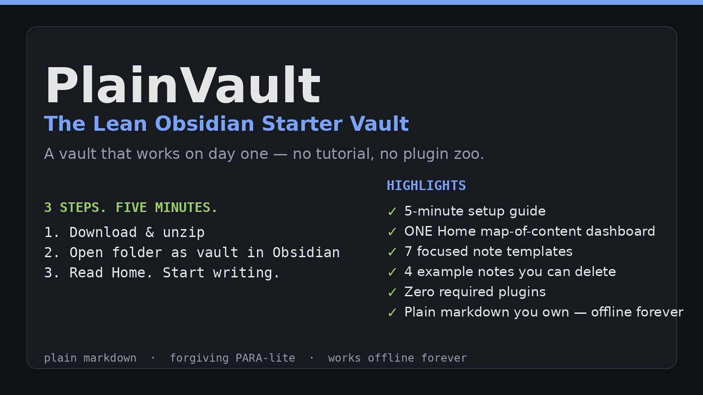
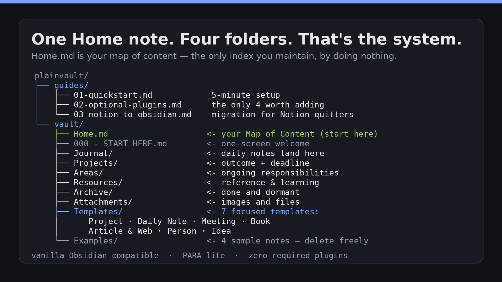
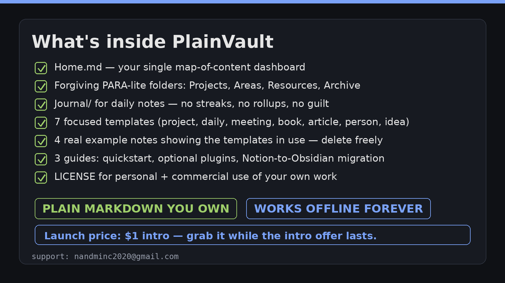

# PlainVault — The Lean Obsidian Starter Vault

**Get PlainVault here: <https://nandminc.gumroad.com/l/plainvault>** — $1 during the intro launch (returns to standard price after).

PlainVault is a starter vault for Obsidian that works on day one. No 45-minute
tutorial, no plugin zoo, no complicated PARA system to memorize. Open it, read
one note, start writing.

> This repository is PlainVault's public listing page on
> [Vault Hub](https://obsidianvaulthub.com). The vault itself is the product
> sold on Gumroad at the link above — this repo describes it and links to it; it
> does not contain or redistribute the vault files.



## What it is

A small folder of plain Markdown files you open in Obsidian as a vault. One
Home note maps everything. A PARA-lite structure (Projects, Areas, Resources,
Archive) plus a Journal, Templates, and Attachments. That's the whole system.

- **Works on day one.** Install = unzip, open the folder as a vault, read one
  note.
- **Zero required plugins.** Optional plugins are covered in a guide if you want
  them later — nothing breaks if you never install one.
- **7 one-screen templates:** project, daily note, meeting, book, article &
  web, person, idea.
- **3 guides:** a 5-minute quickstart, an optional-plugins guide, and a
  Notion-to-Obsidian migration guide.
- **Offline forever, git-friendly, no lock-in.** Your notes are plain files you
  own.



## Who it's for

- You tried Obsidian, got lost configuring it, and never wrote a note.
- You're quitting Notion and want your notes to be plain files you own.
- You want a structure that forgives missed days — nothing breaks if you skip a
  week.
- You want plugins to be optional, not required.

## What's inside the vault

```
vault/
├── 000 - START HERE.md
├── Home.md                  <- your Map of Content
├── Journal/                 <- daily notes land here
├── Projects/                <- anything with an outcome and a deadline
├── Areas/                   <- ongoing responsibilities
├── Resources/               <- interests, reference, knowledge
├── Archive/                 <- done and dormant
├── Templates/               <- 7 templates
├── Attachments/             <- images and files
└── Examples/                <- 4 sample notes showing the templates in use
```

Plus, in the download: `guides/` (quickstart, optional plugins,
Notion-to-Obsidian migration), `README.md`, `LICENSE.txt`, `changelog.md`.



## Install (2 minutes)

1. Download the zip from Gumroad and unzip it.
2. In Obsidian: **Open folder as vault** → select the unzipped `vault/` folder.
3. Read `000 - START HERE.md`, then `Home.md`.

That's it. Nothing else to configure.

## Links

- **Buy PlainVault:** <https://nandminc.gumroad.com/l/plainvault>
- **Support:** nandminc2020@gmail.com

## License

Personal and commercial use for your own notes and work. The vault itself may
not be resold or redistributed. See `LICENSE.txt` in the download.
